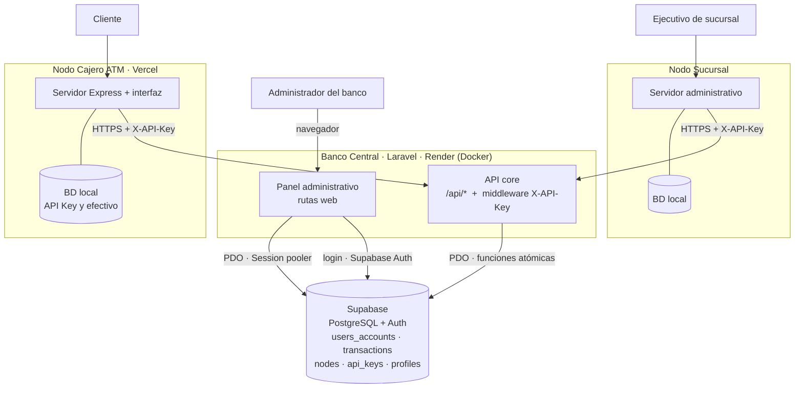
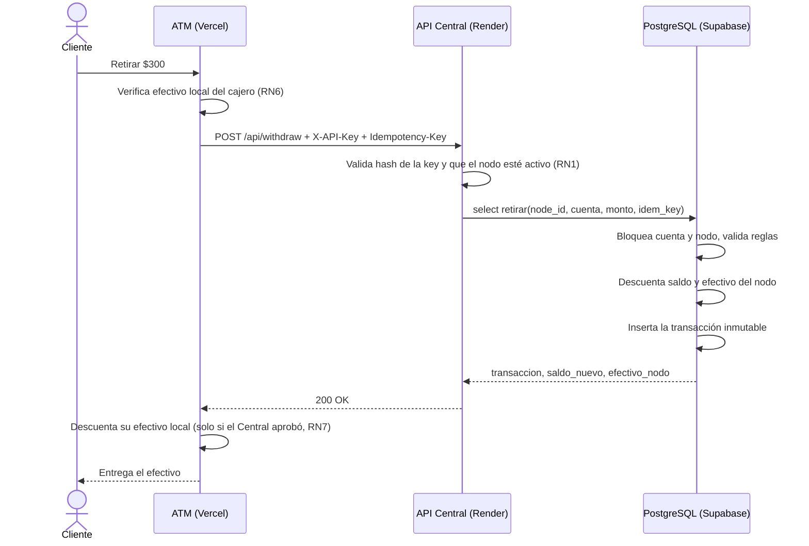

# Banco Central — Sistema Bancario Distribuido (Nodo 1)

Núcleo del sistema bancario distribuido: base de datos centralizada en **Supabase (PostgreSQL)**, **API core** y **panel de administración**, ambos en **Laravel**. Es el único componente que modifica saldos. Las **Sucursales** y los **Cajeros Automáticos (ATM)** son aplicaciones independientes que operan consumiendo esta API con una **API Key**.

> Examen práctico — Sistema Bancario Distribuido.
> Repositorios del sistema: **Banco Central** (este) · Sucursal · Cajero ATM.

---

## 1. Arquitectura

El sistema es **descentralizado en la operación** y **centralizado en la consolidación de datos**: cada nodo funciona por su cuenta (propio repositorio, despliegue, interfaz y lógica local), pero ninguno es dueño de los saldos ni de las transacciones, que viven solo en el Banco Central.

### Diagrama de arquitectura



### Flujo de un retiro en cajero



### Responsabilidades por nodo

| Nodo | Decide | No puede |
|---|---|---|
| **Banco Central** | Saldos, transacciones, alta de nodos, API Keys, efectivo, responsables, reportes globales | — |
| **Sucursal** | Atención al cliente, apertura de cuentas, reportes locales | Modificar saldos directamente |
| **Cajero ATM** | Validar su efectivo físico, interfaz del cliente, su configuración | Modificar saldos ni crear cuentas |

---

## 2. Aplicaciones desplegadas

| Componente | Plataforma | Enlace |
|---|---|---|
| **Banco Central** (API + panel) | **Render** (contenedor Docker) | `https://banco-central-panel.onrender.com/` |
| API — salud del servicio | Render | `https://banco-central-panel.onrender.com/api/health` |
| Panel administrativo | Render | `https://banco-central-panel.onrender.com/` |
| **Cajero ATM** | **Vercel** (serverless) | `https://cajero-topweb.vercel.app/` |
| **Sucursal** | **Render** | `https://sucursal-nodo2-nyl2.onrender.com/` |
| Base de datos | Supabase | Proyecto `https://nfdflikydbhtarcwbrvo.supabase.co` |

**Repositorios:**
- Banco Central: `https://github.com/ReynaldoEGL/ExamenTWBancoCentral.git`
- Sucursal: `https://github.com/<ORG>/sucursal`
- Cajero ATM: `https://github.com/ricardo-rodriguezdesk/Cajero-TOPWEB.git`

> **Nota sobre la plataforma.** Este nodo se despliega en **Render** con Docker, una de las plataformas permitidas en el enunciado. El `Dockerfile` es portable, y el mismo contenedor también puede desplegarse en **Coolify** (self-hosted) sin cambios.
>
> **Aviso de arranque en frío.** En el plan gratuito de Render el servicio se suspende tras un periodo de inactividad y la primera petición puede tardar en responder. Antes de la demostración, abre `/api/health` para despertarlo.

---

## 3. Tecnologías

| Capa | Tecnología |
|---|---|
| Backend y panel | Laravel (PHP 8.4), Blade |
| Gestor de paquetes | Composer |
| Base de datos | Supabase — PostgreSQL |
| Autenticación | Supabase Auth (login de administradores y ejecutivos) |
| Servidor web | Apache 2.4 dentro de Docker (puerto `10000`) |
| Despliegue | Render (Docker) con despliegue continuo desde GitHub |
| Contrato de la API | OpenAPI 3.0.3 (`openapi.yaml`) |

---

## 4. Modelo de datos (Supabase)

Las tablas se crean con los scripts SQL del repositorio (ver [sección 11](#11-scripts-sql-de-supabase)). Los montos usan `numeric(14,2)`.

| Tabla | Propósito |
|---|---|
| `users_accounts` | Cuentas de clientes: id, número de cuenta (10 dígitos generados por una secuencia), titular, saldo, estado (`activa` / `bloqueada`), sucursal que la abrió |
| `transactions` | Registro **inmutable** de cada movimiento: cuenta origen, cuenta destino, monto, tipo (`retiro` / `deposito` / `transferencia`), `node_id`, saldo resultante y timestamp |
| `nodes` | Sucursales y cajeros: tipo, nombre, ubicación, responsable, **efectivo disponible**, activo / inactivo |
| `api_keys` | Key de cada nodo guardada como **hash SHA-256**, prefijo identificador, estado y fecha de revocación |
| `profiles` | Usuarios de Supabase Auth con rol (`admin` / `ejecutivo`) y, si aplica, su sucursal |
| `node_cash_movements` | Auditoría de la asignación de efectivo a nodos (ingreso / egreso, motivo y administrador que lo hizo) |
| `idempotency_keys` | Respuestas guardadas para reintentos seguros (clave primaria `node_id + idempotency_key`) |

**Restricciones principales:**
- `saldo >= 0` y `efectivo_disponible >= 0`.
- `monto > 0` en transacciones y movimientos.
- Un `check` obliga a que cada tipo de transacción lleve las cuentas coherentes (el retiro con origen, el depósito con destino, la transferencia con ambas y distintas).
- Solo puede haber **una API Key activa por nodo**.
- `transactions.node_id` es obligatorio: toda operación queda ligada al nodo que la originó.

---

## 5. Seguridad

| Mecanismo | Descripción |
|---|---|
| **API Key por nodo** | Cada petición lleva `X-API-Key`. El middleware calcula su SHA-256 y la busca en `api_keys` (solo keys activas). La key en texto plano **nunca** se almacena y se muestra **una sola vez** al generarla. |
| **Identidad del nodo** | El `node_id` se deduce de la API Key; nunca viaja en el body. Un nodo no puede suplantar a otro. |
| **Row Level Security** | RLS activado en todas las tablas, **sin políticas** para `anon` ni `authenticated`, y con los permisos revocados. La única excepción es que un usuario autenticado puede leer su propio perfil, para validar su rol al iniciar sesión. |
| **Funciones autorizadas** | `retirar`, `depositar` y `crear_cuenta` son `SECURITY DEFINER` y solo las puede ejecutar `service_role`. Son la única vía para modificar saldos. |
| **Inmutabilidad** | Un trigger en `transactions` bloquea `UPDATE`, `DELETE` y `TRUNCATE`. |
| **Atomicidad** | Cada operación valida, actualiza saldo, actualiza efectivo del nodo e inserta la transacción en **una sola operación**. Las filas se bloquean con `FOR UPDATE` para impedir retiros simultáneos que dejen saldo negativo. |
| **Llaves de Supabase** | `SUPABASE_SERVICE_KEY` solo vive en el servidor (variables de entorno de Render). Nunca en vistas, JavaScript ni el repositorio. |
| **Panel** | Acceso solo con sesión de un usuario cuyo `rol` sea `admin` en `profiles`. |

---

## 6. Reglas de negocio

| # | Regla | Dónde se valida |
|---|---|---|
| RN1 | Solo nodos con API Key válida y activa pueden operar | Middleware de la API |
| RN2 | Solo cuentas **activas** pueden retirar o depositar | Función SQL |
| RN3 | El saldo nunca puede ser negativo | `check` en la tabla + función SQL |
| RN4 | Todo monto debe ser mayor que 0 | Función SQL |
| RN5 | Un retiro requiere saldo suficiente en la cuenta | Función `retirar` |
| RN6 | Un retiro en cajero requiere efectivo físico suficiente en el cajero | Cajero (antes de llamar) y Central (efectivo oficial) |
| RN7 | Si el Central rechaza la operación, el efectivo del cajero no cambia | Cajero |
| RN8 | Toda operación genera una transacción con su nodo de origen | Funciones SQL |
| RN9 | Las transacciones no se pueden modificar ni borrar | Trigger |
| RN10 | El saldo inicial de una cuenta nueva se registra como depósito | Función `crear_cuenta` |
| RN11 | Solo el Banco Central asigna efectivo y genera API Keys | Panel del Central |
| RN12 | Cada nodo tiene un responsable asignado | Panel del Central |

> El tipo `transferencia` existe en el esquema por el enunciado, pero no tiene endpoint en esta versión.

---

## 7. API core

Contrato completo y ejecutable en **[`openapi.yaml`](./openapi.yaml)** (puede abrirse en [Swagger Editor](https://editor.swagger.io)).

**Autenticación:** header `X-API-Key: <key del nodo>`.

| Método | Ruta | Descripción | Quién la usa |
|---|---|---|---|
| GET | `/api/health` | Estado del servicio (sin autenticación) | Todos |
| GET | `/api/node/me` | Valida la key y devuelve el nodo con su efectivo oficial | Sucursal, ATM |
| POST | `/api/accounts` | Crea una cuenta (solo sucursales); el saldo inicial queda como depósito | Sucursal |
| GET | `/api/accounts/{numero}` | Saldo y estado de una cuenta | Sucursal, ATM |
| POST | `/api/withdraw` | Retiro atómico | ATM |
| POST | `/api/deposit` | Depósito atómico | ATM |
| GET | `/api/transactions` | Historial paginado con filtros `numero_cuenta`, `tipo`, `desde`, `hasta`, `page`, `per_page` | Sucursal, ATM |

### Formato de errores

```json
{ "error": "Fondos insuficientes", "codigo": "FONDOS_INSUFICIENTES" }
```

| `codigo` | HTTP | Significado |
|---|---|---|
| `DATOS_INVALIDOS` | 400 | Body, parámetros o header mal formados |
| `API_KEY_INVALIDA` | 401 | Key ausente, inexistente o revocada |
| `NODO_INACTIVO` | 403 | El nodo fue desactivado por el Banco Central |
| `NODO_NO_AUTORIZADO` | 403 | El nodo no puede realizar esa operación (ej. un cajero creando cuentas) |
| `CUENTA_NO_ENCONTRADA` | 404 | No existe el número de cuenta |
| `MONTO_INVALIDO` | 422 | Monto menor o igual a 0 o con más de 2 decimales |
| `CUENTA_BLOQUEADA` | 422 | La cuenta no está activa |
| `FONDOS_INSUFICIENTES` | 422 | Saldo menor al monto |
| `EFECTIVO_NODO_INSUFICIENTE` | 422 | El efectivo oficial del nodo no alcanza |
| `IDEMPOTENCY_CONFLICT` | 422 | La `Idempotency-Key` ya se usó con otra operación, cuenta o monto |
| `ERROR_INTERNO` | 500 | Falla inesperada |

### Idempotencia

`POST /api/withdraw` y `POST /api/deposit` aceptan el header opcional `Idempotency-Key` (UUID) para que un reintento (por ejemplo, tras un *timeout*) **no cobre dos veces**:

- Mismo UUID y mismos datos: se devuelve la respuesta original sin volver a operar.
- Mismo UUID con otra cuenta, monto u operación: `422 IDEMPOTENCY_CONFLICT`.
- Si la operación falla por una regla de negocio, la key no queda guardada y puede reutilizarse.
- La key es única **por nodo**; dos nodos pueden usar el mismo UUID sin chocar.
- La verificación y el registro ocurren dentro de la misma transacción SQL que la operación, de modo que dos peticiones simultáneas con la misma key no pueden ejecutarse a la vez.

### Ejemplo

```bash
curl -X POST https://<URL-DEL-CENTRAL>.onrender.com/api/withdraw \
  -H "X-API-Key: atm_xxxxxxxx" \
  -H "Content-Type: application/json" \
  -H "Idempotency-Key: 3f9c2d8e-6a1b-4c7e-9d52-8b1f0a7e4c10" \
  -d '{"numero_cuenta":"1000000001","monto":300}'
```

```json
{
  "transaccion": {
    "id": 152, "tipo": "retiro", "numero_cuenta": "1000000001",
    "monto": 300, "node_id": 7, "created_at": "2026-10-20T17:30:00Z"
  },
  "saldo_nuevo": 700,
  "efectivo_nodo": 9700
}
```

---

## 8. Panel administrativo

Aplicación Laravel con vistas Blade. El acceso exige iniciar sesión con un usuario de Supabase Auth cuyo rol sea `admin`.

| Pantalla | Qué permite |
|---|---|
| **Inicio de sesión** | Autenticación con correo y contraseña contra Supabase Auth |
| **Resumen** | Sucursales, cajeros, nodos activos, cuentas, saldo agregado de clientes, efectivo asignado a nodos, operaciones del día y transacciones recientes |
| **Nodos** | Listado con filtros por tipo, estado y búsqueda; crear y editar sucursales y cajeros; activar o desactivar; designar responsable |
| **Detalle de nodo** | Estado, efectivo registrado, responsable, **generar o renovar la API Key** (se muestra una sola vez, con botón de copiar), **revocar** keys, **registrar movimientos de efectivo** y ver su auditoría |
| **Transacciones** | Historial global filtrable por cuenta, tipo, **sucursal o cajero** y rango de fechas, con paginación |
| **Reportes** | Por periodo: total de operaciones, importes de retiros y depósitos, operaciones por nodo y efectivo registrado por nodo |

---

## 9. Estructura del repositorio

```
banco-central/
├── app/
│   ├── Http/
│   │   ├── Controllers/
│   │   │   ├── Api/            # API core: nodo, cuentas, operaciones, transacciones
│   │   │   └── Admin/          # Panel: nodos, API Keys, efectivo, transacciones, reportes
│   │   └── Middleware/         # ApiKeyAuth (X-API-Key) y control de acceso del panel
│   └── Support/                # ApiError, Money, PgBoolean
├── bootstrap/app.php           # Alias de middleware y manejo global de errores JSON
├── config/services.php         # Configuración de Supabase
├── database/supabase/          # Scripts SQL (01_tablas, 02_funciones, 03_idempotencia)
├── docker/000-default.conf     # Virtual host de Apache (puerto 10000)
├── public/css/central-admin.css
├── resources/views/
│   ├── layouts/central.blade.php
│   ├── central-login.blade.php
│   └── admin/                  # dashboard, nodes, transactions, reports
├── routes/
│   ├── api.php                 # Rutas de la API core
│   └── web.php                 # Rutas del panel
├── Dockerfile
├── .env.central.example        # Plantilla de variables (sin valores reales)
├── openapi.yaml
└── README.md
```

---

## 10. Variables de entorno

Plantilla en `.env.central.example`. **Nunca** se sube el `.env` real al repositorio.

| Variable | Descripción |
|---|---|
| `APP_NAME`, `APP_ENV=production`, `APP_DEBUG=false` | Configuración de Laravel |
| `APP_KEY` | Se genera con `php artisan key:generate --show` |
| `APP_URL` | URL pública del Central |
| `DB_CONNECTION=pgsql` | Motor de base de datos |
| `DB_HOST` | Host del **Session pooler** de Supabase (`aws-X-REGION.pooler.supabase.com`) |
| `DB_PORT=5432` | Puerto del Session pooler (no usar el Transaction pooler, `6543`) |
| `DB_DATABASE=postgres` | Nombre de la base |
| `DB_USERNAME` | `postgres.<PROJECT_REF>` (lleva el project ref) |
| `DB_PASSWORD` | Contraseña de la base de datos |
| `DB_SSLMODE=require` | SSL obligatorio |
| `SESSION_DRIVER=file`, `CACHE_STORE=file`, `QUEUE_CONNECTION=sync` | Evitan crear tablas de apoyo en Supabase |
| `SUPABASE_URL` | `https://<PROJECT_REF>.supabase.co` |
| `SUPABASE_ANON_KEY` (o `SUPABASE_PUBLIC_KEY`) | Llave pública, usada en el login del panel |
| `SUPABASE_SERVICE_KEY` | Llave de servicio. **Solo servidor.** |

> Se usa el **Session pooler** porque la conexión directa de Supabase es solo IPv6 y muchas plataformas (incluidas Render y los VPS) no la soportan. El Transaction pooler no se usa porque no es compatible con los *prepared statements* de PDO.

---

## 11. Scripts SQL de Supabase

Ejecutar en **Supabase → SQL Editor**, en este orden:

| Orden | Script | Contenido |
|---|---|---|
| 1 | `01_tablas.sql` | Tablas, restricciones, índices, trigger de inmutabilidad y RLS |
| 2 | `02_funciones.sql` | `retirar`, `depositar` y `crear_cuenta` atómicas, y sus permisos |
| 3 | `03_idempotencia.sql` | Tabla `idempotency_keys` y nuevas versiones de `retirar` y `depositar` con `Idempotency-Key` (reemplazan a las del paso 2) |

Verificación de RLS:

```sql
select tablename, rowsecurity from pg_tables where schemaname = 'public' order by tablename;
-- todas deben mostrar rowsecurity = true
```

---

## 12. Ejecución en local

Requisitos: PHP 8.3+ con la extensión `pdo_pgsql`, Composer y un proyecto de Supabase con los scripts ya ejecutados.

```bash
git clone https://github.com/ReynaldoEGL/ExamenTWBancoCentral.git
cd banco-central
composer install
cp .env.central.example .env      # completar con los datos de Supabase
php artisan key:generate
php artisan serve                 # http://localhost:8000
```

Comprobaciones:

```bash
curl http://localhost:8000/api/health
curl -H "X-API-Key: <KEY>" http://localhost:8000/api/node/me
```

> **No** ejecutar `php artisan migrate`: el esquema vive en los scripts SQL de Supabase y las migraciones por defecto de Laravel crearían tablas innecesarias.
> Verificar la extensión con `php -m | grep pdo_pgsql`.

---

## 13. Despliegue en Render y despliegue continuo

El `Dockerfile` usa **dos etapas**:
1. **Construcción:** instala `pdo_pgsql`, `mbstring` y `bcmath`, y ejecuta `composer install --no-dev --optimize-autoloader`.
2. **Ejecución:** `php:8.4-apache` con `mod_rewrite` y `mod_headers`, sirviendo `public/` por el puerto **10000** (el que Render detecta por defecto).

### Pasos
1. En Render: **New → Web Service** y conectar el repositorio de GitHub.
2. Entorno: **Docker** (usa el `Dockerfile` de la raíz).
3. Rama de despliegue: `main`.
4. Cargar las variables de entorno de la [sección 10](#10-variables-de-entorno) en el panel de Render.
5. **Health Check Path:** `/api/health`.
6. Desplegar y verificar ` https://banco-central-panel.onrender.com/api/health`.

### Despliegue continuo
Render está vinculado al repositorio de GitHub. Con **Auto-Deploy** activado, cada `git push` a `main` construye una imagen nueva y redespliega automáticamente.

Flujo de trabajo del equipo:
- Una rama por tarea (`feature/api`, `feature/panel`, ...).
- Integración a `main` mediante **Pull Request**.
- El merge a `main` dispara el redespliegue.

Evidencia para la demostración: historial de despliegues de Render (pestaña *Events*) mostrando el despliegue ligado al *commit* de GitHub.

---

## 14. Demostración (flujo de 5 pasos)

**Paso 1 — Banco Central:** en el panel, crear la sucursal y el cajero, generar sus API Keys y asignarles efectivo.

**Paso 2 — Sucursal:** con su API Key, registrar un cliente con saldo inicial de $1,000.

```bash
curl -X POST https://<URL-DEL-CENTRAL>.onrender.com/api/accounts \
  -H "X-API-Key: <KEY_SUCURSAL>" -H "Content-Type: application/json" \
  -d '{"titular":"Juan Pérez","saldo_inicial":1000}'
```

**Paso 3 — Banco Central:** en el panel (*Transacciones*) verificar que la cuenta y el depósito inicial existen, y que el saldo es $1,000.

**Paso 4 — Cajero ATM:** con su API Key, retirar $300.

```bash
curl -X POST https://<URL-DEL-CENTRAL>.onrender.com/api/withdraw \
  -H "X-API-Key: <KEY_CAJERO>" -H "Content-Type: application/json" \
  -d '{"numero_cuenta":"<NUMERO>","monto":300}'
```

**Paso 5 — Consistencia:** en Supabase, comprobar saldo = $700 y la transacción registrada. Demostrar la inmutabilidad:

```sql
select a.numero_cuenta, a.saldo from users_accounts a where a.numero_cuenta = '<NUMERO>';
select id, tipo, monto, node_id, saldo_resultante, created_at
  from transactions order by id desc limit 5;

update transactions set monto = 1 where id = (select max(id) from transactions);
-- ERROR: La tabla transactions es inmutable: no se permite UPDATE
```

### Casos de error demostrables

| Caso | Resultado esperado |
|---|---|
| Key inválida o revocada | `401 API_KEY_INVALIDA` |
| Nodo desactivado en el panel | `403 NODO_INACTIVO` |
| Retiro mayor al saldo | `422 FONDOS_INSUFICIENTES` |
| Cuenta bloqueada | `422 CUENTA_BLOQUEADA` |
| Un cajero intenta crear una cuenta | `403 NODO_NO_AUTORIZADO` |
| Reintento con la misma `Idempotency-Key` | `200` con la respuesta original, sin segundo cobro |
| Misma `Idempotency-Key` con otro monto | `422 IDEMPOTENCY_CONFLICT` |

---

## 15. Equipo y responsabilidades

| Integrante | Responsabilidad |
|---|---|
| `Sanchez Rojas Jorge Laurencio` | Supabase (tablas, funciones, RLS, Auth) y API core del Central |
| `Emmanuel Reynaldo Gaspar Lara` | Panel administrativo del Central y despliegue |
| `Victor Manuel Mendoza Lara` | Nodo Sucursal |
| `Ricardo Rodríguez Arellano` | Nodo Cajero ATM |

---

## 16. Documentación relacionada

- [`openapi.yaml`](./openapi.yaml) — contrato de la API core.
- README de la Sucursal y del Cajero ATM, en sus respectivos repositorios.